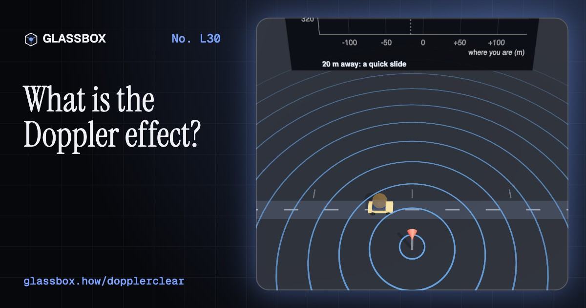
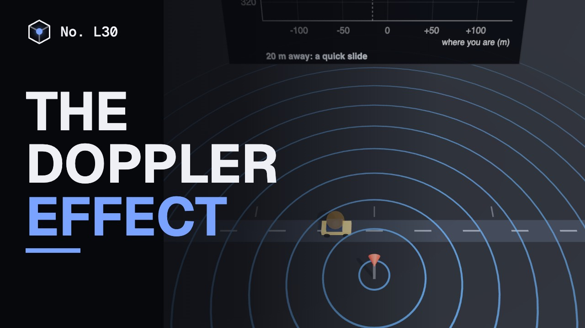
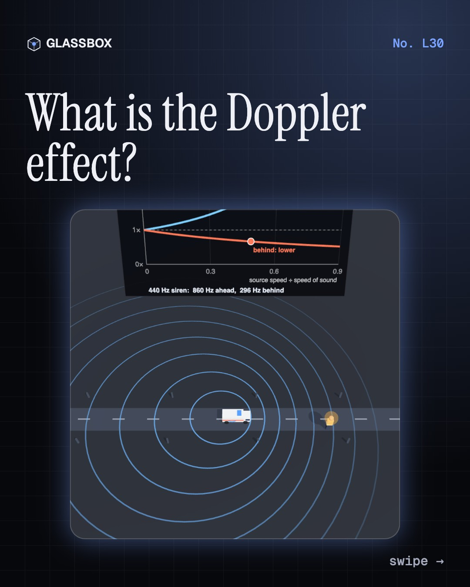
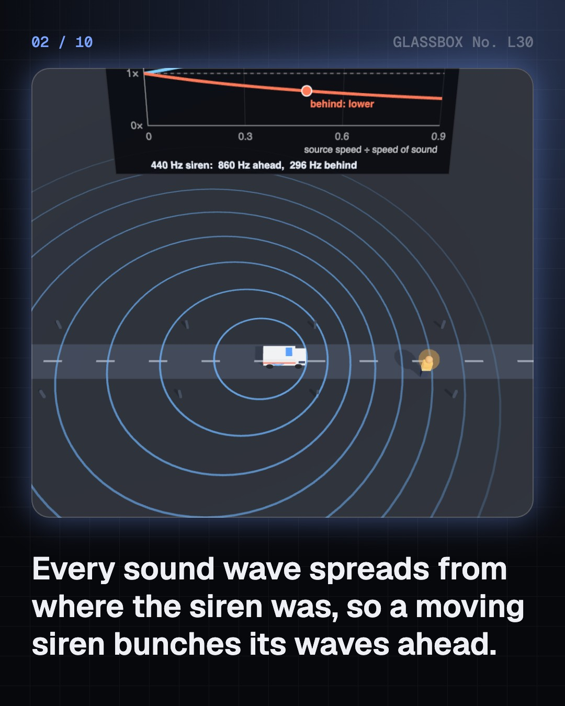
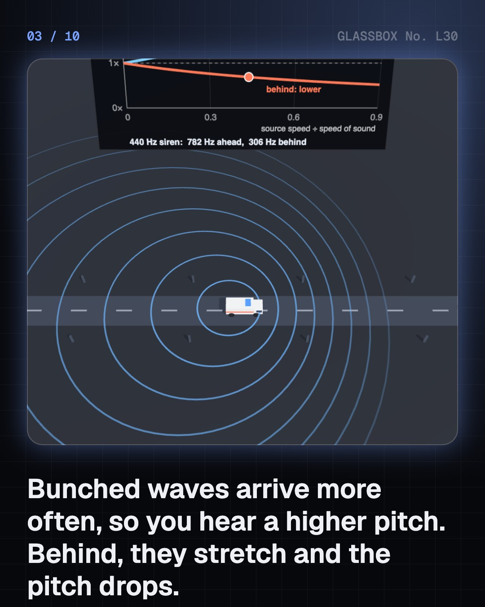
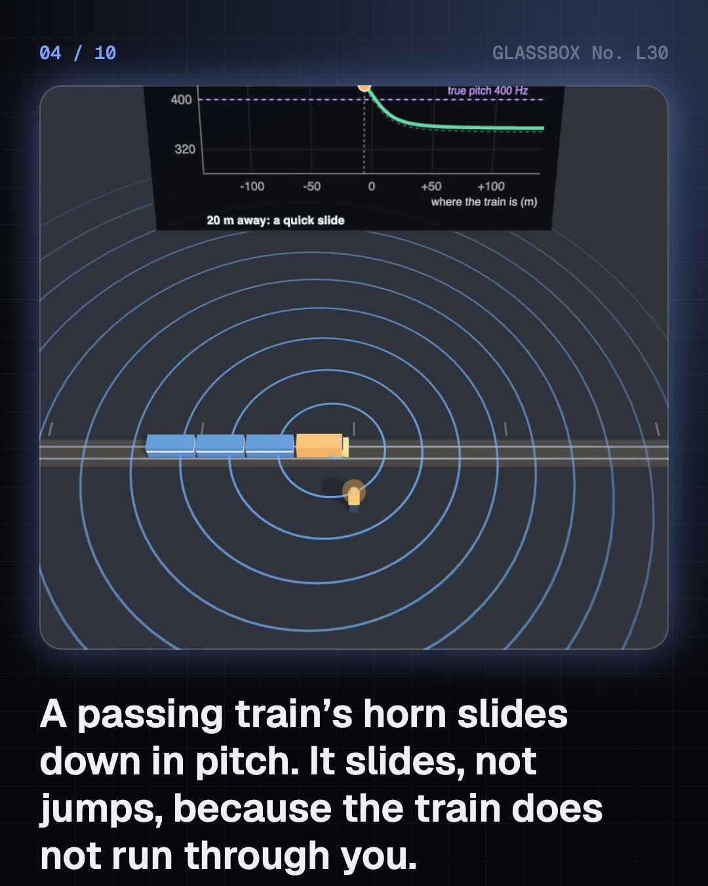

<!-- glassbox:start -->
<!-- Generated from glassbox.json by the Glassbox hub (npm run readme -- dopplerclear). Edit glassbox.json, not this block. -->
<p align="center"><a href="https://glassbox.how/e/dopplerclear/"></a></p>

<h1 align="center">The Doppler effect</h1>

<p align="center"><b>What is the Doppler effect?</b><br>Why does a siren drop in pitch as it passes? Watch each sound wave spread from where the source was, hear the pitch slide as a train goes by, clock a cricket ball with radar, find the wind inside a storm, and push a jet through the sound barrier.</p>

<p align="center"><a href="https://glassbox.how/dopplerclear/"><b>▶ Play with it</b></a> &nbsp;·&nbsp; <a href="https://glassbox.how/e/dopplerclear/">Read the 60-second explainer</a> &nbsp;·&nbsp; <a href="https://glassbox.how/dopplerclear/glassbox/reel.mp4">Watch the 40-second video</a></p>

<p align="center">
  <a href="https://glassbox.how/e/dopplerclear/"></a>
  <a href="https://glassbox.how/e/dopplerclear/"></a>
  <a href="LICENSE"></a>
  <a href="LICENSE-CONTENT.md"></a>
  <a href="#privacy"></a>
</p>

## In 60 seconds

1. **A moving source squeezes its waves.** Every crest spreads from where the source was when it made it, at the wave's own speed. A moving source starts each crest closer to the last, so crests bunch up ahead and stretch out behind: f′ = f × (v + vₒ) ÷ (v − vₛ).
2. **Why the pitch slides as it passes.** A horn at 110 km/h is heard at 439 Hz coming and 367 Hz going. Only the speed along the line to your ear counts, so the pitch slides through the true note as the train comes level. Nearer the track, the slide is quicker.
3. **An echo is a speedometer.** Bounce a wave off something moving and the echo is shifted twice: Δf = 2 f v ÷ c. A radar gun clocks a cricket ball this way, and Doppler ultrasound measures how fast blood flows and in which direction.
4. **Reading the sky.** Weather radar maps the wind inside storms in green and red. Shifted lines in starlight reveal a star wobbling at 56 m/s as a planet swings it, and galaxies receding faster the farther they are: v = H₀ × d.
5. **Where it breaks, and three myths.** At Mach 1 the formula divides by zero and the waves pile into a shock cone, heard as a sonic boom all along the flight path. Light follows a relativistic rule. And an approaching siren's pitch is steady: only its loudness rises.

## Words worth knowing

| Term | Meaning |
|---|---|
| **Doppler effect** | The change in received frequency when a wave's source and receiver are getting closer or farther apart. |
| **Wavefront** | A crest spreading out from where the source was when it was emitted, at the wave speed of the medium. |
| **Radial velocity** | The part of a speed that points straight towards or away from the observer. Only this part causes a Doppler shift. |
| **Doppler shift (Δf)** | The difference between the frequency sent and the frequency received. For an echo it is about 2 f v ÷ c. |
| **Redshift and blueshift** | Light stretched to longer wavelengths by motion away, or squeezed to shorter ones by motion towards. |
| **Mach number** | Speed divided by the speed of sound. Above Mach 1 the wavefronts form a cone with sin μ = 1 ÷ M. |
| **Sonic boom** | The bang heard when the shock cone of a supersonic object sweeps past. |
| **Hubble's law** | The farther away a galaxy is, the faster it recedes: v = H₀ × d. |

## A short history

**From horn players on a Dutch train in 1845 to weather radar, heart scans and the discovery that the universe is expanding.**

- **1842** · A professor wonders why stars have colours (Christian Doppler, Prague, Bohemia)
- **1845** · Horn players on a train test it (C. H. D. Buys Ballot, Between Utrecht and Maarssen)
- **1868** · The first speed of a star (William Huggins, Tulse Hill, London)
- **1887** · A bullet's shock wave is photographed (Ernst Mach and Peter Salcher, Prague and Fiume (now Rijeka))
- **1912** · Andromeda is rushing towards us (Vesto Slipher, Lowell Observatory, Flagstaff, Arizona)
- **1929** · The farther, the faster (Georges Lemaître and Edwin Hubble, Leuven, Belgium, and Mount Wilson, California)
- **1949** · Radar starts catching speeders (John L. Barker Sr. and Ben Midlock, Glastonbury, Connecticut)
- **1955** · Ultrasound listens to a beating heart (Shigeo Satomura, Osaka University)

The full story, with 19 moments, charts, people and 32 sources: [glassbox.how/e/dopplerclear/history](https://glassbox.how/e/dopplerclear/history/). The data lives in [`history.json`](history.json).

## Video and slides

Made with the Glassbox studio from this box's storyboard (`window.glassbox.director`). Free to reuse under CC BY 4.0.

<a href="https://glassbox.how/dopplerclear/glassbox/video.mp4"></a>

<p><a href="glassbox/slide-1.jpg"></a> <a href="glassbox/slide-2.jpg"></a> <a href="glassbox/slide-3.jpg"></a> <a href="glassbox/slide-4.jpg"></a></p>

| File | What | Size |
|---|---|---|
| [`glassbox/reel.mp4`](https://glassbox.how/dopplerclear/glassbox/reel.mp4) | Reel / Short, with captions and soundtrack | 1080×1920 |
| [`glassbox/video.mp4`](https://glassbox.how/dopplerclear/glassbox/video.mp4) | YouTube video, with captions and soundtrack | 1920×1080 |
| `glassbox/slide-1…10.jpg` | Instagram carousel | 1080×1350 |
| `glassbox/thumb.jpg` | YouTube thumbnail | 1280×720 |
| `glassbox/cover.jpg` | Share card and repo social preview | 1200×630 |
| [`glassbox/history-reel.mp4`](https://glassbox.how/dopplerclear/glassbox/history-reel.mp4) | “History in 10 moments” Reel / Short | 1080×1920 |
| `glassbox/history-slide-*.jpg` | History carousel | 1080×1350 |
| `glassbox/post.json` | Post copy and schedule used by the publish kit | |

## Privacy

This box has no accounts and no ads, and it ships its own fonts and libraries. When you run it yourself it sends nothing anywhere. On glassbox.how, the site's `/bar.js` also loads Glassbox's analytics: **Google Analytics** to count visits (it asks first in the EU, UK and Switzerland, and stays off when your browser sends Global Privacy Control or Do Not Track) and **ClickTrust** to detect bots.

It remembers a few things **in your own browser only**, and never sends them anywhere:

| Browser storage key | What it holds |
|---|---|
| `dopplerclear.v1` | Which chapters you have opened, your best quiz scores, and sound on or off. |

Exactly what each one sees is at [glassbox.how/privacy](https://glassbox.how/privacy/).

## Licences

- **Code:** [MIT](LICENSE). Use it, change it, ship it.
- **Explanations, text, images and videos** (`glassbox.json`, `glassbox/`): [CC BY 4.0](LICENSE-CONTENT.md). Credit “Glassbox, glassbox.how/e/dopplerclear”.
- **Third-party parts** keep their own licences: [three.js](https://threejs.org) (MIT), [Geist, Instrument Serif](https://openfontlicense.org) (SIL OFL 1.1).
- The Glassbox name and logo aren't covered by either licence. See the [terms](https://glassbox.how/terms/).

Found a mistake? [Open an issue](https://github.com/bdeeps/dopplerclear/issues). Corrections happen in public.
<!-- glassbox:end -->

## Run it

It's plain HTML, CSS and JavaScript. No build step and no dependencies. Run locally, it contacts no other website.

```bash
python3 -m http.server 8000
```

Three.js and the fonts ship in `vendor/` and `fonts/`, so it also works offline.

Then open http://localhost:8000.

## How it's built

| File | What |
|---|---|
| `index.html`, `css/app.css` | The page and its styles |
| `js/app.js`, `js/stage.js`, `js/ui.js`, `js/kit.js` | The shared Glassbox 3D engine: chapters, 3D stage, controls, quiz, video director |
| `js/chapters/*.js` | One file per chapter: the 3D model, controls, text, key terms, quiz and video scenes |
| `js/doppler.js` | Shared Doppler maths (the straight-line formula, the general case solved from where each sound was emitted, light's relativistic version), wavefront rings, the tone that follows the computed pitch, chart boards and small models |
| `glassbox.json` | Title, question, explainer beats, key terms, browser storage and credits shown on glassbox.how |
| `reel` in each chapter | The storyboard the Glassbox studio records into short videos |
| `glassbox/` | The published video, slides, thumbnail and post copy |
| `fonts/`, `vendor/three/` | Self-hosted Geist and Instrument Serif (SIL OFL 1.1) and three.js (MIT) |
